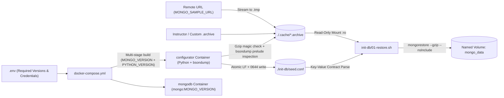

# System Architecture

## Overview

`mongodb-selective-seeder` adopts a **Declarative Contract Architecture** paired with **Dynamic Archive Introspection** and **Strict `.env` Parameterization** across two uncoupled containers:

1. **Setup Stage (`configurator` service, Compose profile `setup`):** Built via a multi-stage Dockerfile combining `mongo:${MONGO_VERSION}` official tools (`mongorestore` and `bsondump`) with `python:${PYTHON_VERSION}-slim`. It scans `./.cache/` for `.archive` files or downloads from `MONGO_SAMPLE_URL`, inspects archive contents offline using `bsondump`, enriches known metadata with clean fallbacks for custom databases, and atomically generates `init-db/seed.conf`.
2. **Database Runtime (`mongodb` service):** Runs `mongo:${MONGO_VERSION}` with strict `.env` credentials. On first boot (`/data/db` empty), `init-db/01-restore.sh` parses `init-db/seed.conf` safely without `eval`/`source` and invokes `mongorestore` selectively.

## Data-Flow Diagram



## Multi-Stage Tool Packaging (`configurator/Dockerfile`)

- Stage 1 pulls `mongo:${MONGO_VERSION}` solely to extract official `/usr/bin/mongorestore` and `/usr/bin/bsondump` binaries.
- Stage 2 pulls `python:${PYTHON_VERSION}-slim`, installs `libgssapi-krb5-2` (the only non-default shared library required by the dynamically linked MongoDB tools), copies the binaries into `/usr/local/bin/`, and validates `mongorestore --version && bsondump --version` during image build.
- **Preserved Invariants:** Zero `/var/run/docker.sock` mounts and zero custom BSON binary decoders written in Python.

## Dynamic Introspection & Gzip Auto-Detection

1. **Multi-Archive Discovery:** `list_cached_archives()` scans `./.cache/*.archive` (ignoring `.gitkeep`, `.tmp`, and undersized artifacts) so students can switch between Atlas sample archives and instructor-provided custom backups.
2. **Gzip Detection:** `is_gzip_archive()` inspects the first two bytes of the chosen file against gzip magic bytes (`\x1f\x8b`), reading the uncompressed prelude via `gzip.open` when compressed or directly otherwise.
3. **Offline Prelude Parsing:** `read_archive_prelude_bytes()` strips MongoDB's 4-byte `mongodump` archive header (`\x6d\xe2\x99\x81`) and feeds the prelude stream to `bsondump --quiet` via `subprocess.run(..., shell=False)`. Because `bsondump` stops cleanly with a non-zero exit after emitting header JSON lines and hitting the binary collection delimiter, `parse_introspection_output()` treats decoded database/collection JSON documents as the source of truth rather than relying on process exit code alone.
4. **Metadata Enrichment Fallback:** `KNOWN_DATASET_METADATA` optionally enriches friendly descriptions for standard Atlas sample databases while keeping selection strictly bound to databases actually present inside the archive. Uncatalogued databases render with `"Custom / Uncatalogued dataset"`.

## Declarative Contract Format (`init-db/seed.conf`)

```ini
# Declarative dataset seed contract consumed by init-db/01-restore.sh
# Regenerate via: docker compose run --rm configurator
ARCHIVE_FILE=sampledata.archive
ARCHIVE_GZIP=false
DATASETS=sample_mflix,sample_supplies
```

`init-db/01-restore.sh` parses this contract line-by-line inside a `main()` function without `eval` or `source`, validates `ARCHIVE_FILE` against `^[a-zA-Z0-9._-]+$` and each database name against `^[a-zA-Z0-9_-]+$`, and passes `--gzip` and `--nsInclude="<db>.*"` conditionally via Bash arrays.

## Strict `.env` Governance & Cross-OS Safety

- Required runtime versions (`MONGO_VERSION`, `PYTHON_VERSION`), credentials (`MONGO_INITDB_ROOT_USERNAME`, `MONGO_INITDB_ROOT_PASSWORD`), and download targets (`MONGO_SAMPLE_URL`, `ARCHIVE_FILENAME`) use Docker Compose `${VAR:?error}` syntax to fail immediately if `.env` is incomplete.
- Only host interface/port bindings (`MONGO_HOST`, `MONGO_PORT`) retain fallback defaults.
- All generated contracts use atomic `.tmp` staging, `os.fsync()`, `newline="\n"` LF endings, and `0o644` permissions so non-root UID `999` (`mongodb`) can always read them.
